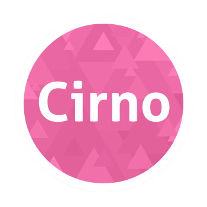

<div align="center" class="percent">
   </br>
   
</div>

# Cirno Recycle+

> 基于 [Freezer-Team/Cirno](https://github.com/Freezer-Team/Cirno)（原 [Nep-Timeline/Cirno](https://github.com/Nep-Timeline/Cirno)）**二次修改**
> 作者：**flyingr** · 版本：**1.2.2** · 协议：**GPL-3.0**

**先说明：这是二改，不是原作者的作品。** 原项目「Cirno」的版权归 Nep-Timeline / Freezer-Team 所有，本仓库只是在其基础上加了内存回收和前台内存压制功能，并保持同样的 GPL-3.0 开源协议。

---

## 一句话介绍

Cirno 负责「把后台应用冻住省 CPU」，Cirno Recycle+ 在它基础上多做两件事：**把冻住的应用占的内存收回来**，以及**在你允许的范围里压一压前台应用的内存增长**。所有新加的功能都能在 App 里用开关控制。

## 它解决什么问题

- 应用被 `cgroup.freeze` 冻结之后**不再运行，但 RSS / PSS 还占着**，系统内存该紧张还是紧张。
- 冻结的进程**收不到 `onTrimMemory`、也不会自己 GC**，靠应用自己释放内存这条路走不通。
- 前台应用内存一路涨，系统只能去杀后台（包括你刚冻结的应用），**冻了个寂寞**。

所以这个项目改成从内核侧解决：直接通过 cgroup v2 回收页、通过系统的进程压缩接口把冷页标记成可回收页，冻结进程不需要解冻也能生效。

## 相对原版 Cirno 新增了什么

| # | 功能 | 说明 | 有 UI 开关 |
|---|---|---|---|
| 1 | **L0 `memory.reclaim`** | 对后台应用 cgroup 写 `memory.reclaim`，直接回收页缓存 / 匿名页（Linux 5.19+） | ✅ |
| 2 | **PSI 智能触发** | 读 `/proc/pressure/memory`，`some` / `full` 取大者分级，带冷却、提前停止、高压多轮 | ✅ |
| 3 | **只回收已冻结应用** | 默认只动冻结了的进程，没冻结的（可能马上切回前台）不碰 | ✅ |
| 4 | **swap / zram 换出** | 向 `memory.reclaim` 写 `N swap`，把匿名页换到 zram；没 swap 自动回退普通回收 | ✅ |
| 5 | **L2 `compactApp`** | 复用系统 `CachedAppOptimizer` 做进程内存压缩（`MADV_COLD` / `MADV_PAGEOUT`） | ✅ |
| 6 | **前台内存压制（实验性）** | 给 top-app cgroup 写 `memory.high` 软上限，前台应用内存失控时先限流而不是整机 OOM；ROM 原值会持久化保存、关开关时恢复 | ✅ |
| 7 | **前台冷页压缩（实验性）** | 内存有压力时对可见应用调用 `compactApp`，压制前台进程常驻内存 | ✅ |
| 8 | **前台组回收（实验性）** | 直接回收 `foreground` cgroup（可见但没在交互的应用），不含当前 top-app | ✅ |
| 9 | **仅息屏时回收** | 亮屏玩手机时不回收，优先保证手感 | ✅ |
| 10 | **立即回收一次** | 无视 PSI 阈值和冷却，手动强制跑一轮，用来验证效果 | ✅ |
| 11 | **配置热重载** | 改完开关写回 JSON，system_server 2 秒内生效，不用重启 | ✅ |
| 12 | **刷入自动装 App** | 刷模块 zip 时自动安装配套 APK；recovery 刷入时 APK 会在开机后自动补装 | — |
| 13 | **冻结状态显示** | 首页 / 详情页直接显示「已冻结 / 部分冻结 / 前台运行 / 后台播放 / 后台运行」，带进程数；数据由 system_server 每 2 秒写到 `RuntimeState.json` | — |
| 14 | **单应用冻结选项** | 首页**长按应用**弹出面板：参与自动冻结、播放音频时是否冻结、冻结时保留网络 / 闹钟、允许内存回收、白名单 | ✅ |
| 15 | **自定义进程冻结** | 列出应用的所有进程，可设置「全部 / 只冻选中 / 排除选中」规则，也可以手动冻结 / 解冻单个进程 | ✅ |
| 16 | **简化设置界面** | 基础设置 + 三档回收强度预设（保守 / 均衡 / 激进），二十多个参数收进默认折叠的「高级设置」，并支持恢复默认 | ✅ |
| 17 | **应用内更新提示** | 启动时读 GitHub 仓库根目录的 `update.json` 检查新版本（12 小时内只查一次），有新版弹窗提示并跳下载；也可以关掉自动检查、在设置里手动检查 | ✅ |
| 18 | **深色模式** | 跟随系统 / 强制浅色 / 强制深色，状态栏 / 导航栏图标跟着切换 | ✅ |
| 19 | **主题色与莫奈取色** | 6 个预设色 + 自定义 `#RRGGBB`；Android 12+ 可打开「莫奈取色」，从系统壁纸取色（Material You） | ✅ |
| 20 | **首页搜索** | 右上角搜索按钮，按应用名 / 包名实时过滤 | — |
| 21 | **后台应用优先排序** | 首页把正在后台运行的应用排到最前面（按进程数排序），一眼看到谁还占着内存；可在设置里关掉 | ✅ |
| 22 | **完整进程列表** | 应用面板列出 `PackageManager` 里声明的全部进程（包含未运行的子进程），可以提前给还没启动的进程设规则 | ✅ |
| 23 | **白名单可部分冻结** | 白名单应用仍然整应用不冻结 / 不回收，但可以手动冻结子进程，或把规则设成「只冻选中 / 排除选中」让子进程自动部分冻结；主进程永远不会被冻 | ✅ |
| 24 | **FCM / 推送保护** | GMS、GSF、Play 商店等推送基础设施默认不冻结；推送广播到达时先解冻目标应用，并给 15 秒投递窗口；推送广播永不被「冻结进程跳过广播」拦掉 | ✅（单应用「收到推送时解冻」） |
| 25 | **服务启动唤醒** | 冻结应用被 `startService` / `bindService` 拉起（部分 FCM 版本 / 厂商推送 / 后台任务）时，先解冻 15 秒让服务正常启动 | — |
| 26 | **Google 全家桶可单独选择冻结** | 默认仍保护 GMS / GSF / Play 商店以免切断 FCM；不使用 FCM 时，可在应用列表里逐个打开「允许冻结 Google 服务」，再决定是否自动冻结 | ✅（单应用开关） |
| 26 | **保留网络连接（Android 16 修复）** | 打开应用的「冻结时保留网络连接」后，Android 16 上也不再上报 frozen 状态、不再切断网络 | ✅（单应用开关） |

> 关于「GitHub 上能压制前台进程内存的模块」：我确实去找了。结论是**没有找到现成的、公开的、专门做 top-app `memory.high` 的 Magisk / LSPosed 模块**（GitHub 搜 `memory.high` 基本都是无关项目）。所以第 6、7、8 项是照着 AOSP 文档和几个内存优化项目的思路自己写的实现，不是直接搬的代码。没有引入 `process_madvise` JNI、没有改 lmkd 参数、没有改 zram 配置——这些要么需要 root shell / `CAP_SYS_NICE`，要么容易把设备调崩，不适合放进 LSPosed 模块里，所以没做。

## 安装

**前提**

- Android 12+（API 31+），内核 5.10+（cgroup v2）
- Magisk / KernelSU / APatch 任选其一
- **LSPosed**（Zygisk 版，API 101+）——没有 LSPosed 这个模块不会生效

**步骤**

1. 从 Release 页面下载 `Cirno-Recycle-Plus-v1.2.2.zip`。
2. 在 Magisk / KernelSU / APatch 里刷入（**建议在已开机的系统里刷**，这样刷入时就能自动装 APK；recovery 刷入也能用，只是 APK 要等开机后由 `service.sh` 自动补装）：
   - 刷入时会**自动安装配套 APK**（`com.flyingr.cirnorecycle`），并创建配置目录 `/data/misc/CirnoRecycle`；
   - 如果安装时 PackageManager 还没就绪、导致 APK 安装失败，模块会在**下次开机后自动补装一次**。
3. 重启手机。
4. 打开 **LSPosed** → **模块** → 启用 **Cirno Recycle+**。
   - 作用域已经在 APK 里静态声明为「系统框架（system）」，不需要手动勾选。
5. 打开 **Cirno Recycle+** App：
   - 左上角齿轮 → 设置（外观 / 主题、通用设置、内存回收、高级设置）；
   - 首页列表会显示每个应用当前的冻结状态（已冻结 / 部分冻结 / 前台运行 / 后台播放 / 未运行），右上角可以搜索；
   - **长按**任意应用 → 弹出这个应用单独的冻结面板；点一下应用也能进同一个详情页。

> 升级时直接刷入新 zip 覆盖即可，配置会保留。

## 外观与通用设置

设置页最上面是「外观 / 主题」和「通用设置」两张卡（这些是 App 自己的偏好，存在本地 SharedPreferences，不需要 root）：

- **主题模式**：跟随系统 / 浅色 / 深色；
- **莫奈取色**：Android 12+ 从系统壁纸取色（Material You），打开后自定义主题色不生效；
- **主题色**：6 个预设色块，或者点「自定义」输入 `#RRGGBB`，所有界面立即换色；
- **自动检查更新**：启动时检查 GitHub 上的 `update.json`（12 小时内最多一次），也可「立即检查」；
- **后台应用优先排序**：首页把正在后台运行的应用排到最前面（默认开）；
- **进程列表显示未运行进程**：应用面板的进程列表是否包含「已声明但当前没启动」的进程（默认开）。

## 设置项说明

配置存在 `/data/misc/CirnoRecycle/GlobalSettings.json` 的 `memory` 字段里，App 里改完立即写回，system_server 热重载。界面上分成「外观 / 主题」「通用设置」「基础设置」「前台内存压制」「高级设置」：基础设置里可以用三档预设（保守 / 均衡 / 激进）一键套用一组数值；所有字段（包括预设涉及的）都能在高级设置里单独调整。全部字段如下（也能手动改 JSON，改完 2 秒内生效）：

| 字段 | 默认值 | 界面开关 | 说明 |
|---|---|---|---|
| `enabled` | `true` | 启用内存回收 | 总开关，关了所有回收 / 前台压制都停 |
| `dryRun` | `false` | 只打印计划 | 只写日志不真回收，先用来确认候选应用 |
| `enableReclaim` | `true` | L0 · memory.reclaim | 是否写 cgroup `memory.reclaim` |
| `useSwapReclaim` | `false` | 允许换出到 swap/zram | 写 `N swap`，内核不支持会自动回退 |
| `enableCompact` | `true` | L2 · compactApp | 是否调系统进程压缩 |
| `frozenOnly` | `true` | 只回收已冻结应用 | 关闭后未冻结的后台应用也会被回收 |
| `screenOffOnly` | `false` | 仅息屏时回收 | 息屏才触发 |
| `sampleIntervalMs` | `5000` | 采样间隔滑条 | 2–30 秒 |
| `psiSomeThreshold` | `5.0` | 触发阈值滑条 | PSI some/full avg10 百分比，1–30 |
| `psiHighMultiplier` | `2.0` | 高压判定倍数滑条 | 1–6 |
| `psiStopThreshold` | `1.0` | 提前停止阈值滑条 | `0` 到触发阈值（`psiSomeThreshold`），0.1 步长 |
| `cooldownMs` | `15000` | 冷却时间滑条 | 两次回收周期最小间隔 |
| `maxRoundsPerCycle` | `2` | 高压连续回收轮数滑条 | 1–4 |
| `maxAppsPerRound` | `4` | 每轮最多回收应用数滑条 | 1–8 |
| `minCgroupBytes` | `32MB` | 最小回收收益滑条 | 8–256MB |
| `maxBytesPerApp` | `128MB` | 单应用单次上限滑条 | 32–512MB |
| `reclaimRatio` | `0.10` | 单应用回收比例滑条 | 5%–50% |
| `foregroundGuard` | `false` | top-app memory.high 软上限 | 前台压制，实验性 |
| `foregroundHighRatio` | `0.80` | 软上限占物理内存滑条 | 50%–95% |
| `foregroundColdCompact` | `false` | 前台冷页压缩 | 对可见应用做 compact，实验性（需要 L2 开启） |
| `foregroundColdIntervalMs` | `30000` | 前台冷页压缩间隔滑条 | 10–120 秒 |
| `foregroundReclaim` | `false` | 前台组直接回收 | 回收 foreground cgroup，实验性 |
| `requestSeq` | `0` | 立即回收一次按钮 | App 里点按钮写时间戳，system_server 收到后强制跑一轮 |

**建议**：先保持默认（只回收冻结应用 + L0/L2），在 App 里看几天日志；确认稳定后再动阈值，或者开 `dryRun` 看候选是否符合预期。前台那几项是实验性的，卡顿就关掉。

## 冻结状态与单应用设置

### 冻结状态

首页应用列表每一项下面会显示（每 2 秒刷新）：

| 显示 | 含义 |
|---|---|
| 已冻结（首页徽章显示 `❄ 已冻结`，详情面板显示 N/N 进程） | 该应用所有存活进程都被 `cgroup.freeze` 冻结 |
| 部分冻结（M/N 进程） | 进程规则 / 手动操作只冻结了一部分进程 |
| 前台运行 | 应用可见（正显示在前台），不会被冻结 |
| 后台播放 | 应用正在后台播放音频，按该应用的设置可能暂不冻结 |
| 后台运行 · N 进程 | 还在后台、尚未被冻结（或正在走冻结延迟） |
| 未运行 | 当前没有存活进程 |

状态文件是 `/data/misc/CirnoRecycle/RuntimeState.json`（system_server 原子写、App 只读）。
显示「状态未知」说明读不到这个文件：确认 LSPosed 里已启用本模块并重启过。

### 长按应用：单应用冻结面板

**首页长按应用**（或者点一下应用进详情页）会打开这个应用的独立面板：

- **冻结选项**：参与自动冻结 / 后台播放音频时不冻结 / 冻结时保留网络连接 / 冻结时保留闹钟 / 允许内存回收 / **收到推送时解冻** / 白名单；Google 应用额外有一个 **允许冻结 Google 服务**（默认关闭，打开后才会解除保护）；
- **自定义进程冻结**：先选规则（全部进程 / 只冻选中 / 排除选中），再在进程列表里勾选要参与规则的进程；进程列表会列出 `PackageManager` 里声明的全部进程（包含当前没运行的，主进程排在最前），也可以对单个正在运行的进程直接点「冻结 / 解冻」（手动冻结同样受当前进程规则约束，规则排除的进程会提示先调整规则）；
- **白名单应用**：仍然整应用不冻结、不参与内存回收，但可以手动冻结它的子进程；把规则设成「只冻选中 / 排除选中」后，子进程会按规则自动部分冻结。**主进程永远不会被冻结**（白名单应用跳过了 Binder 临时解冻，主进程被冻住会直接无响应）；
- **Google 全家桶**：默认仍受保护，应用列表里名字前会显示 `(Google 保护)`，不能冻结。不使用 FCM / 谷歌推送时，点进对应应用打开「允许冻结 Google 服务」即可解除保护并参与自动冻结；关闭开关会恢复保护并解冻。使用 FCM 的用户保持默认即可；
- **冻结整个应用 / 解冻整个应用** 按钮（白名单应用禁用整应用冻结），以及实时的「已冻结 / 部分冻结」状态和每个进程的 pid。

这些选项按 `包名#用户ID` 存在 `ApplicationSettings.json` 的 `appOptions` 字段里，每个应用互相独立。

### 手动冻结的安全限制

- 应用正在**前台**时，system_server 会拒绝冻结它的进程（否则会把你正在用的界面冻住），面板会提示并禁用按钮；
- 正在录音 / 定位 / 使用 VPN 的应用会被拒绝（进程级的「冻结」按钮同样会检查）；
- 开了「后台播放音频时不冻结」的应用在播放时也会被拒绝；
- 手动冻结进程时会校验 pid 对应的进程启动时间，进程已经退出、pid 被系统复用给别的进程时会拒绝并提示刷新；
- 手动解冻后，如果这个应用又有 Binder / 广播唤醒，Cirno 可能过几秒又把它冻结，属于正常的保活机制。
- 在长按面板里关掉「参与自动冻结」后，system_server 会在 2 秒内主动解冻这个应用已经冻结的进程，不需要手动点解冻。

## 日志在哪

- App 内：设置页「运行状态」卡片，直接看 PSI 和最近日志。
- 文件：`/data/misc/CirnoRecycle/log/current.log`
- logcat：`adb logcat -s CirnoRecycle`

```bash
adb shell 'tail -f /data/misc/CirnoRecycle/log/current.log'
```

日志里正常能看到：

```
内存回收模块已启动, cgroup v2 = true, memory.reclaim = true, PSI = true, top-app memory.high = false
内存压力变化: PSI(memory) some avg10=12.30% full avg10=3.75% -> 中等
内存回收 com.example.app: 210.4MB -> 154.8MB (请求 21.0MB, 实际 55.6MB)
内存回收完成: 压力=中等, 应用数=2, 共回收 72.1MB, 压缩进程数=3
前台冷页压缩 com.example.app: 2 个进程 (压力=中等)
```

（`内存回收完成` 只在本轮真的有动作时才打印；前台冷页压缩需要手动打开对应开关。）

## 工作原理（简版）

```
Memory HandlerThread（后台优先级）每 sampleIntervalMs 跑一次
        │
        ▼
读 /proc/pressure/memory ── 低于阈值 ──► 空转（前台压制开关仍然维持 memory.high）
        │ 达到阈值
        ▼
从 Cirno 的 AppRecord 里挑候选（系统/白名单/可见/音频/录音/定位/VPN 全部排除；默认只挑已冻结）
        │
        ▼
按 cgroup memory.current 从大到小
        ├── L0：写 memory.reclaim（可选 swap）→ 读回收前后差值
        └── L2：compactApp → MADV_COLD / MADV_PAGEOUT
        │
        ▼
重新读 PSI，压力降下来就提前停；高压时按 maxRoundsPerCycle 再来一遍
```

更详细的设计、内核接口、失败降级逻辑见 [MEMORY_MODULE.md](MEMORY_MODULE.md)。

## 自己构建

本仓库构建需要 **JDK 25 + Android SDK 36**（compileSdk/targetSdk 36，Java source/target 25）。

```bash
# 只构建 APK
./gradlew assembleRelease

# 一键构建 APK + 跑单元测试 + 打包模块 zip（Windows）
powershell -ExecutionPolicy Bypass -File scripts\build-release.ps1

# 一键构建（Linux / macOS / CI；macOS 自带 shasum，脚本已做兼容）
bash scripts/package-module.sh
```

产物：

- APK：`app/build/outputs/apk/release/app-release.apk`（仓库自带公开测试签名，见 [signing/README.md](signing/README.md)）
- 模块 zip：`dist/Cirno-Recycle-Plus-v1.2.2.zip`
- 校验值：`dist/CHECKSUMS.txt`

## 目录结构

```
app/                        Android 应用（LSPosed 模块主体）
  src/main/java/.../memory/ 内存回收 / 前台压制实现
  src/main/java/.../runtime/ 运行时状态通道（RuntimeState.json / RuntimeActions.json）
  src/main/java/.../client/  App 侧的状态读取 / 操作下发 / 单应用选项读写 / 进程枚举 / 更新检查 / 本地偏好
  src/main/java/.../screen/ Compose 界面（MainScreen / ApplicationScreen / AppSettingsSheet / MemoryScreen / SettingsCards / UpdateDialog）
  src/main/java/.../ui/     主题（深色模式 / 自定义主题色 / 莫奈取色）
  src/test/java/.../memory/ 纯 JVM 单元测试
  src/test/java/.../configs/ 应用选项 / 进程规则单元测试
  src/test/java/.../client/ 版本比较 / 进程名规范化单元测试
module/                     刷入用的 Magisk/KernelSU/APatch 模块骨架
  customize.sh              刷入时自动安装 APK
  service.sh                开机兜底安装 / 修配置目录权限
  action.sh                 模块「操作」按钮：打印状态 + 打开设置
scripts/                    一键构建 / 打包脚本
signing/                    公开测试签名密钥
dist/                       打包产物（git 忽略）
```

## 常见问题

**Q：刷完重启了，但没有任何日志 / 内存回收没效果？**
A：先确认 LSPosed 里已经启用本模块并重启过；再看 App 设置页的日志和 PSI 是否正常。没有 LSPosed 时模块代码根本不会加载。

**Q：日志里提示「当前内核没有 top-app/foreground 的 memory.high 接口」？**
A：正常。不同 ROM 的 cgroup 布局不一样，前台压制是「探测到才启用」，探测不到就自动跳过，不影响冻结和内存回收。

**Q：L0 日志显示「无收益」（`memory.reclaim` 写入失败）？**
A：常见于内核版本低于 5.19、该 cgroup 目录没有 `memory.reclaim`、或者 cgroup 里确实已经没东西可回收。会自动降级走 L2 进程压缩。

**Q：首页的应用一直显示「状态未知」，看不到「已冻结」？**
A：说明 App 读不到 `RuntimeState.json`。依次检查：LSPosed 里是否启用了本模块并重启过；模块是否被禁用；`/data/misc/CirnoRecycle/RuntimeState.json` 是否存在（可以用 root 文件管理器看，或 `adb shell su -c 'ls -l /data/misc/CirnoRecycle'`）。状态文件超过 90 秒没更新会被当成过期，所以模块没跑时界面会显示「状态未知」而不是过期的旧状态。

**Q：长按面板里的「冻结」按钮是灰的 / 点了没反应？**
A：应用正在前台时禁止手动冻结（避免卡住正在用的界面）；正在录音 / 定位 / VPN / 后台播放（且开了「播放音频时不冻结」）也会被拒绝。执行结果会以 Toast 形式提示原因。

**Q：手动冻结之后，为什么过几秒应用又自己解冻了？**
A：Cirno 的保活机制：应用收到 Binder / 广播 / 媒体按键等唤醒时会临时解冻并在几秒后重新冻结。手动操作只改变「当前这一刻」的状态，不会覆盖这套机制；想长期只冻某个进程，用「自定义进程冻结」的规则。

**Q：检查更新一直失败 / 看不到新版本提示？**
A：应用内的更新检查会依次尝试 `raw.githubusercontent.com` 和 jsDelivr 镜像；国内网络访问 GitHub raw 经常超时，失败时静默跳过、不影响使用。确认手机能访问 GitHub 后到设置页点「立即检查」即可。新版本信息来自仓库根目录的 [`update.json`](update.json)。

**Q：不用 FCM / 谷歌推送，想把 Google 全家桶也冻掉？**
A：v1.2.2 起可以逐个选择：Google 应用默认仍受保护（名字前显示 `(Google 保护)`），点进应用后打开「允许冻结 Google 服务」即可解除保护并参与自动冻结；关闭该开关会恢复保护并主动解冻。使用 FCM 的用户不要打开这个开关，否则 GMS 被冻结后推送会断。

**Q：v1.2.1 一打开应用列表就闪退？**
A：v1.2.1 的白名单集合用了 `Set.of(...)`，里面 `app.revanced.android.gms` 重复了一次，Java 在类初始化时直接抛 `IllegalArgumentException`，导致 App / system_server 加载 `CommonConstants` 就崩溃。v1.2.2 已改为 `LinkedHashSet` 去重构造，并加了回归测试；升级到 v1.2.2 即可。

**Q：装了模块之后 FCM / 推送收不到了？**
A：v1.2.1 已针对这条链路修复（v1.2.2 保留并加固）：
- GMS / GSF / Play 商店等推送基础设施默认保护，不会冻结；
- FCM 广播到达时会先把目标应用解冻，并给 15 秒投递窗口（应用面板里可关「收到推送时解冻」）；
- 推送广播不会再被「冻结进程跳过广播」拦掉；
- 部分通过 `startService` / `bindService` 投递的推送会先解冻 15 秒。
如果仍然收不到，先看 `/data/misc/CirnoRecycle/log/current.log` 里有没有 `MESSAGE PUSH`（说明推送广播到了、模块已解冻）；没有的话多半是 GMS 本身没连上 FCM（DNS / 端口 / 代理问题）或目标应用的通知权限被关。也可以在应用面板里把该应用加入白名单排除干扰后再测。

**Q：会不会把后台应用杀掉？**
A：不会。本项目只冻结进程（`cgroup.freeze`）、回收内存页 / 压缩进程，不杀进程、不发 SIGKILL。杀进程是系统 LMKD 的事。

**Q：和原版 Cirno 冲突吗？**
A：包名不同（`com.flyingr.cirnorecycle`），可以共存；但两个冻结器同时开会互相抢 cgroup 状态，**建议只留一个**。

**Q：刷入时提示 APK 安装失败 / 重启后手机上找不到 App？**
A：先看 `/data/adb/modules/cirno_recycle_plus/install.log`。如果模块目录里还有 `apk/CirnoRecyclePlus.apk`，可以直接用 root 文件管理器手动安装；如果安装成功后 `apk/` 已被清理，**重新刷一次模块 zip** 即可重新安装。

**Q：刷入模块时提示「没有检测到 LSPosed」？**
A：这只是提示。LSPosed 必须在刷入前就装好（Zygisk 版 + 已启用），否则模块代码不会加载。装好 LSPosed 后重新刷入模块并重启即可。

**Q：能卸载吗？**
A：在 root 管理器里删除模块并重启即可。支持 `/data/adb/service.d` 的 root 方案（Magisk、较新的 KernelSU/APatch）会通过清理脚本自动卸载配套 App；如果你的环境没有执行该脚本，重启后 App 可能仍在，手动卸载 `com.flyingr.cirnorecycle` 即可。配置目录默认保留，彻底清理请手动 `rm -rf /data/misc/CirnoRecycle`。（会变成猫娘）

## 二改声明 & 版权

- 本项目是 **[Freezer-Team/Cirno](https://github.com/Freezer-Team/Cirno)**（原 Nep-Timeline/Cirno）的二次修改版本，**不是原创项目**。
- 上游协议为 **GPL-3.0**，本项目同样以 **GPL-3.0** 发布，完整协议见 [LICENSE](LICENSE)。分发二进制时请保留本仓库源码与协议声明。
- 本次二改的主要修改点：新增内存回收子系统（`app/src/main/java/nep/timeline/cirno/memory/`）、运行时状态与手动冻结通道（`runtime/` / `client/`）、单应用冻结选项与进程级冻结（含白名单应用的子进程部分冻结）、设置界面简化与外观 / 主题系统（`MemoryScreen` / `SettingsCards` / `ui/Theme.kt`）、首页搜索与后台优先排序、应用内更新检查（`update.json`）、刷入自动安装 APK 的 Magisk 模块（`module/`）、构建 / 打包脚本（`scripts/`），以及若干稳定性修复（配置热重载死循环、日志递归、白名单集合不可变等）。详细改动见 [CHANGELOG.md](CHANGELOG.md)。
- 本项目**免费**，不会以任何方式强制收费；二次分发请同样保持开源。

## 致谢

- [Nep-Timeline](https://github.com/Nep-Timeline) / [Freezer-Team](https://github.com/Freezer-Team) —— Cirno 原作者
- [libxposed](https://github.com/libxposed) —— LSPosed 模块 API
- [topjohnwu/libsu](https://github.com/topjohnwu/libsu) —— root 权限读写
- AOSP 文档：[Memory Limiter](https://source.android.com/docs/core/perf/memory-limiter)、[cgroup v2](https://docs.kernel.org/admin-guide/cgroup-v2.html)、[LMKD](https://source.android.com/docs/core/perf/lmkd)
- 设计思路参考（未复制代码）：[A1Memory](https://github.com/OneB1ank/A1Memory)（GPL-3.0）、[Frosty](https://github.com/Drsexo/Frosty)（GPL-3.0）、[MemKeep](https://github.com/qvq9999/MemKeep)（MIT）、[memadvise](https://github.com/Zouuup/memadvise)（MIT）、[Adkimsm/Cirno](https://github.com/Adkimsm/Cirno)（GPL-3.0）
